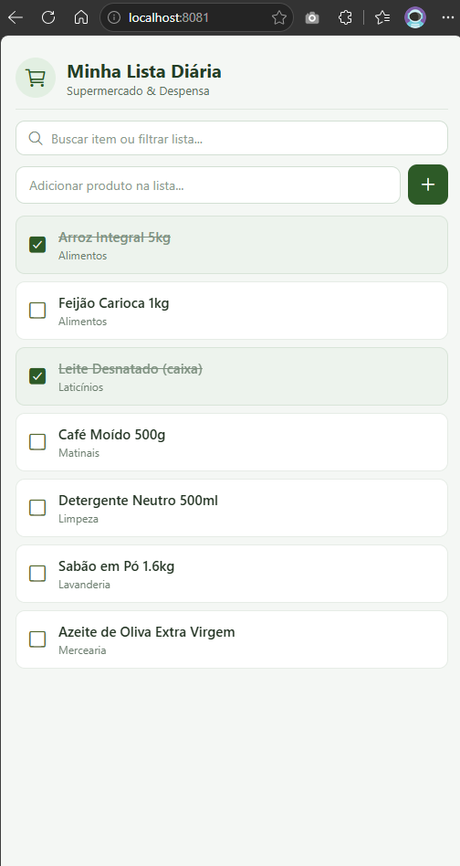
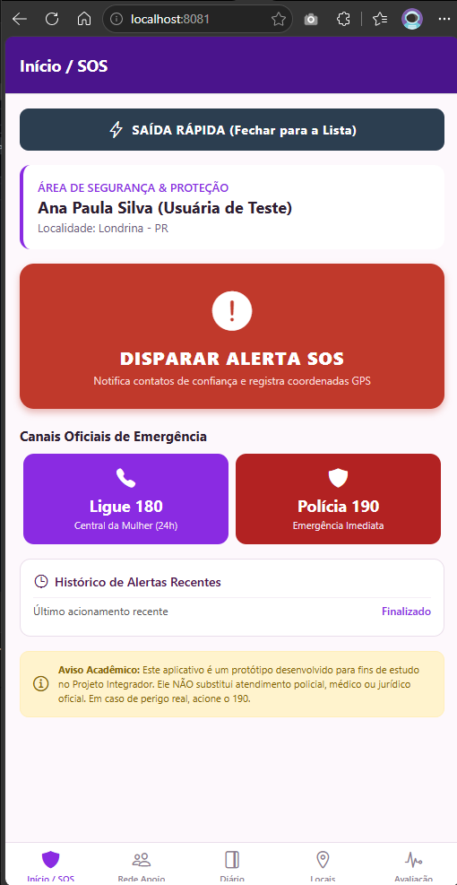
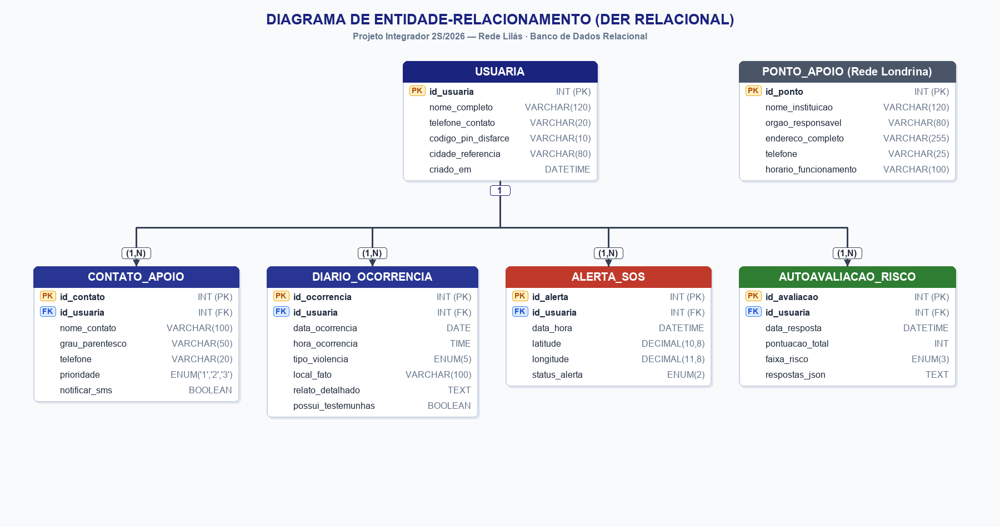
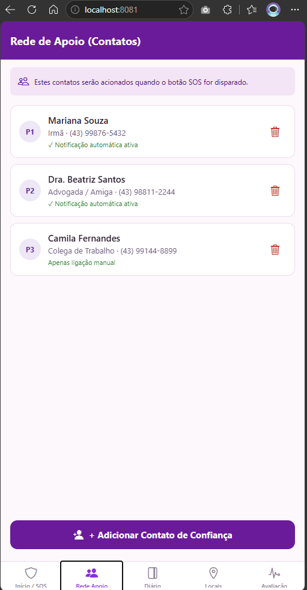
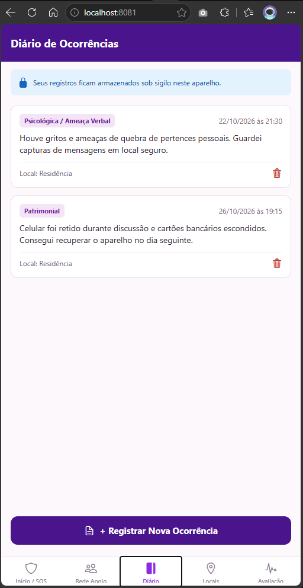
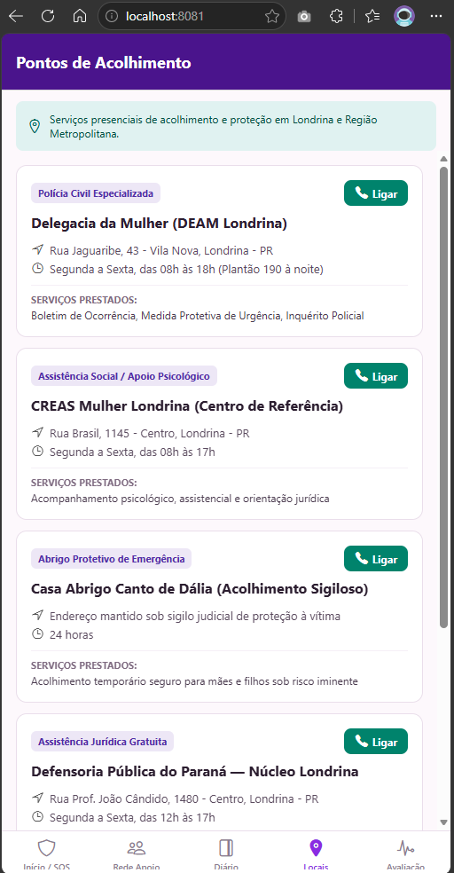
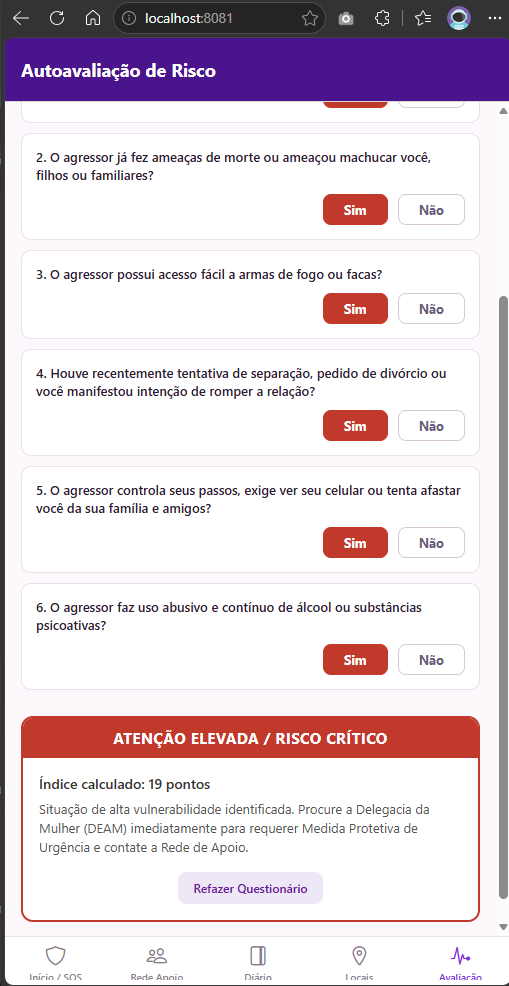
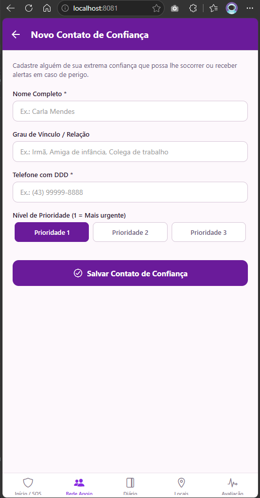
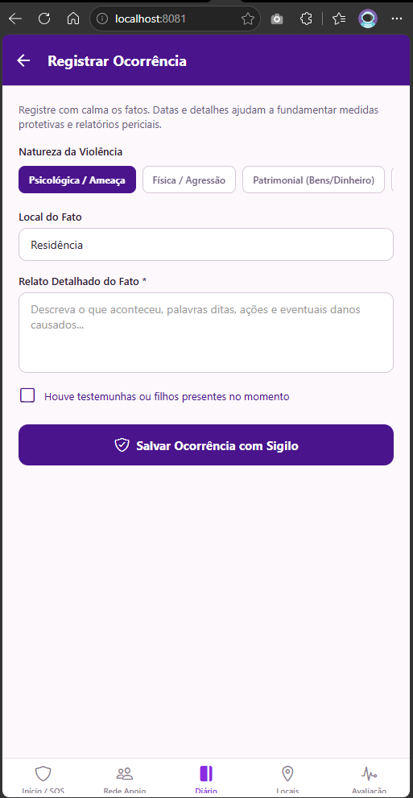
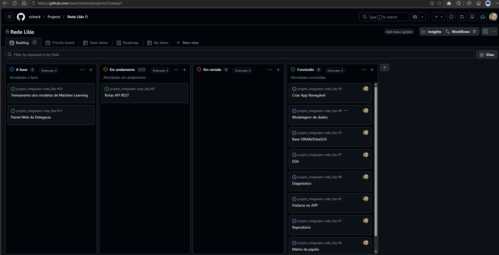

# PROJETO INTEGRADOR — 2º SEMESTRE DE 2026
## UNIVERSIDADE POSITIVO — CAMPUS LONDRINA
### CURSO DE ANÁLISE E DESENVOLVIMENTO DE SISTEMAS
**Disciplinas Integradas:** Desenvolvimento Móvel & Data Science  
**Professor Responsável:** Alex Junior Nunes  
**Grupo:** Apoio Mulher (Londrina)  
**Integrantes:** Mateus Zichack & Samuel Augusto  
**Tema Oficial:** Violência contra a Mulher — Aplicativo de Apoio Camuflado  

---

# DOCUMENTO DA ENTREGA 1: KICKOFF E PLANEJAMENTO
**Projeto:** Rede Lilás — Aplicativo de Apoio e Segurança com Fachada Camuflada  
**Nome da Fachada (Disfarce):** Minha Lista Diária (Supermercado & Despensa)  

---

## 1. Apresentação e Contexto do Projeto

A violência doméstica e familiar contra a mulher é uma violação grave de direitos humanos e um desafio estrutural de segurança pública e saúde no Brasil. Em situações de violência doméstica continuada, os agressores frequentemente exercem controle coercitivo sobre os aparelhos celulares das vítimas, monitorando contatos, redes sociais e aplicativos instalados. 

O presente projeto propõe o desenvolvimento de um **aplicativo mobile de apoio camuflado**, acompanhado de **painel web de monitoramento em tempo real** e **módulo preditivo de Data Science**, desenhado para permitir que mulheres vulnerabilizadas consigam acionar socorro, registrar evidências e buscar suporte institucional sem alertar seus agressores.

> **Diretrizes Éticas e Aviso Acadêmico (Obrigatório):**  
> Este projeto constitui um protótipo estritamente acadêmico para fins de formação técnico-científica. O aplicativo não substitui os canais oficiais de emergência policial ou atendimento médico/jurídico. Toda informação e dado de teste utilizado no desenvolvimento é fictício ou integralmente anonimizado. Em situações reais de violência: **Ligue 180** (Central de Atendimento à Mulher, 24 horas) ou **Ligue 190** (Polícia Militar, emergência).

---

## 2. O Desafio Criativo: Mecanismo de Disfarce e Fachada

### 2.1 Escolha e Justificativa do Disfarce: "Minha Lista Diária"
O grupo escolheu como disfarce um aplicativo de **Lista de Compras de Supermercado e Gestão de Despensa Doméstica**, sob o nome de **"Minha Lista Diária"**.

**Justificativas:**
1. **Inocuidade e Normalidade Doméstica:** Listas de supermercado são aplicativos universais, rotineiros e desinteressantes para um agressor. A sua presença no celular não desperta desconfiança ou ciúmes.
2. **Fachada Totalmente Funcional:** O aplicativo abre com itens de compras reais (Arroz, Café, Leite), permite marcar caixas de seleção (checkboxes) e adicionar novos itens, garantindo que mesmo se o agressor pegar o telefone aberto, verá uma lista de mantimentos comum.
3. **Mecanismo de Entrada Duplo:**
   - **Gatilho Principal (Código PIN):** Na barra de busca de itens de compras, ao digitar o código numérico `1800` (ou `*180#`), o aplicativo substitui instantaneamente a fachada pela **Área Segura (Rede Lilás)**.
   - **Gatilho Alternativo (Toque Longo):** Ao manter o dedo pressionado por 2 segundos sobre o título "Minha Lista Diária" no topo da tela, uma confirmação discreta permite a troca de tela.
4. **Mecanismo de Saída Rápida (Quick Exit):** Em todas as telas da área confidencial existe um botão de destaque permanente: **"SAÍDA RÁPIDA ⚡ (Fechar para a Lista)"**. Com um único clique, o app destrói a visualização de apoio e retorna imediatamente à lista de mantimentos sem pedir confirmação ou senha.

#### Evidências Visuais da Camuflagem:

  
  &nbsp;&nbsp;&nbsp;&nbsp;
  

<em>Figura 1: Comparativo da Fachada Camuflada ("Minha Lista Diária") e a Área Segura de Apoio (Rede Lilás) acionada após o PIN 1800.</em>

---

## 3. Matriz de Papéis e Responsabilidades

Conforme as Seções 4.1 e 4.3 do Documento Orientador, a equipe distribui de forma equilibrada a responsabilidade pelos **CRUDs e telas em Mobile** e pelas **etapas do pipeline de Data Science**.

| Integrante | CRUD e Telas sob Responsabilidade (Mobile + API) | Cursa Data Science? | Etapa de DS sob Responsabilidade | Contato / GitHub |
|---|---|---|---|---|
| **Mateus Zichack** | **Rede de Apoio (Contatos de Confiança)** e **Pontos de Acolhimento**: Modelagem, rotas RESTful na API (CRUD), interface React Native, priorização de contatos (P1/P2/P3), discagem de acolhimento e Fachada de Compras ("Minha Lista Diária"). | **Sim** | **Governança, Qualidade dos Dados e EDA**: Ficha de governança LGPD, diagnóstico nas 5 dimensões, pipeline de tratamento (limpeza, imputação e outliers) e análise exploratória completa com gráficos. | `MateusZichack` |
| **Samuel Augusto** | **Diário Seguro de Ocorrências** e **Alertas SOS & Saída Rápida**: Modelagem relacional e formulário confidencial de incidentes (tipos de violência, data/hora e relatos probatórios), disparo de socorro simulado com GPS e mecanismo de desmonte instantâneo (*Quick Exit*). | **Sim** | **Modelagem Preditiva e Avaliação de Riscos (Entregas 3 e 4)**: Planejamento supervisionado (Regressão Logística e Random Forest Classifier), engenharia de features, validação cruzada 5-fold e foco no Recall da classe de reincidência. | `SamuelAugusto` |

*Nota: Caso ingressem novos integrantes no grupo (o edital prevê até 4 alunos), a matriz pode ser desmembrada em 4 papéis individuais conforme detalhado no repositório.*

---

## 4. Modelagem de Dados Formal (DER)

A modelagem de dados foi estruturada para suportar a integração entre aplicativo mobile, back-end RESTful e módulo preditivo.

#### Diagrama Visual de Entidade-Relacionamento:

  

<em>Figura 2: Diagrama de Entidade-Relacionamento (DER Relacional) com chaves primárias (PK), chaves estrangeiras (FK) e cardinalidades 1:N.</em>

### 4.1 Entidades, Atributos e Tipos de Dados

1. **USUARIA** (Perfil Camuflado):
   - `id_usuaria`: INT AUTO_INCREMENT (PK)
   - `nome_completo`: VARCHAR(120) NOT NULL
   - `telefone_contato`: VARCHAR(20) NOT NULL
   - `codigo_pin_disfarce`: VARCHAR(10) NOT NULL DEFAULT '1800'
   - `cidade_referencia`: VARCHAR(80) NOT NULL DEFAULT 'Londrina - PR'
   - `criado_em`: DATETIME DEFAULT CURRENT_TIMESTAMP

2. **CONTATO_APOIO** (Rede de Confiança):
   - `id_contato`: INT AUTO_INCREMENT (PK)
   - `id_usuaria`: INT NOT NULL (FK referenciando USUARIA)
   - `nome_contato`: VARCHAR(100) NOT NULL
   - `grau_parentesco`: VARCHAR(50) NOT NULL
   - `telefone`: VARCHAR(20) NOT NULL
   - `prioridade`: ENUM('1', '2', '3') NOT NULL DEFAULT '1'
   - `notificar_sms`: BOOLEAN NOT NULL DEFAULT TRUE

3. **DIARIO_OCORRENCIA** (Registro Documentado):
   - `id_ocorrencia`: INT AUTO_INCREMENT (PK)
   - `id_usuaria`: INT NOT NULL (FK referenciando USUARIA)
   - `data_ocorrencia`: DATE NOT NULL
   - `hora_ocorrencia`: TIME NOT NULL
   - `tipo_violencia`: ENUM('Física', 'Psicológica', 'Patrimonial', 'Moral', 'Sexual') NOT NULL
   - `local_fato`: VARCHAR(100) NOT NULL
   - `relato_detalhado`: TEXT NOT NULL
   - `possui_testemunhas`: BOOLEAN NOT NULL DEFAULT FALSE
   - `criado_em`: DATETIME DEFAULT CURRENT_TIMESTAMP

4. **PONTO_APOIO** (Rede Institucional de Londrina):
   - `id_ponto`: INT AUTO_INCREMENT (PK)
   - `nome_instituicao`: VARCHAR(120) NOT NULL
   - `orgao_responsavel`: VARCHAR(80) NOT NULL
   - `endereco_completo`: VARCHAR(255) NOT NULL
   - `telefone`: VARCHAR(25) NOT NULL
   - `horario_funcionamento`: VARCHAR(100) NOT NULL
   - `servicos_oferecidos`: TEXT NOT NULL

5. **ALERTA_SOS** (Acionamentos de Emergência):
   - `id_alerta`: INT AUTO_INCREMENT (PK)
   - `id_usuaria`: INT NOT NULL (FK referenciando USUARIA)
   - `data_hora`: DATETIME DEFAULT CURRENT_TIMESTAMP
   - `latitude`: DECIMAL(10, 8) NOT NULL
   - `longitude`: DECIMAL(11, 8) NOT NULL
   - `status_alerta`: ENUM('Novo', 'Em atendimento', 'Concluído') DEFAULT 'Novo'

6. **AUTOAVALIACAO_RISCO** (Questionário Integrado a Data Science):
   - `id_avaliacao`: INT AUTO_INCREMENT (PK)
   - `id_usuaria`: INT NOT NULL (FK referenciando USUARIA)
   - `data_resposta`: DATETIME DEFAULT CURRENT_TIMESTAMP
   - `pontuacao_total`: INT NOT NULL
   - `faixa_risco`: ENUM('Baixa', 'Moderada', 'Elevada') NOT NULL
   - `respostas_json`: TEXT NOT NULL

### 4.2 Relacionamentos do Sistema
- `USUARIA (1,N) ── CADASTRA ──> CONTATO_APOIO` (Uma usuária possui múltiplos contatos de confiança).
- `USUARIA (1,N) ── REGISTRA ──> DIARIO_OCORRENCIA` (Uma usuária registra ocorrências históricas).
- `USUARIA (1,N) ── DISPARA ──> ALERTA_SOS` (Acionamentos vinculados à usuária de teste e enviados ao painel).
- `USUARIA (1,N) ── RESPONDE ──> AUTOAVALIACAO_RISCO` (Triagem periódica associada à conta).

---

## 5. Protótipo de Telas e Arquitetura de Navegação

### 5.1 Telas Principais do Aplicativo
1. **Tela 1 — Fachada (Disfarce):** Lista de compras funcional com busca, checkboxes e campos insuspeitos.
2. **Tela 2 — Início & SOS (Área Segura):** Botão principal de SOS, botões rápidos para ligar 180 e 190, botão de Saída Rápida e aviso acadêmico obrigatório.
3. **Tela 3 — Rede de Apoio:** Lista dos contatos de confiança com prioridade e botão para adicionar novo contato.
4. **Tela 4 — Formulário de Novo Contato:** Inputs com validação de nome, parentesco, telefone e prioridade.
5. **Tela 5 — Diário de Ocorrências:** Histórico de relatos protegidos com data, tipo de violência e botão para registrar novo fato.
6. **Tela 6 — Pontos de Apoio:** Lista com delegacias especializadas (DEAM), CREAS, CRAS e Casa Abrigo de Londrina com botão de chamada direta.
7. **Tela 7 — Autoavaliação de Risco:** Questionário padronizado com cálculo dinâmico da faixa de atenção.

### 5.2 Fluxo de Navegação e Transições
| Fluxo de Telas | Tipo de Transição | Comportamento Técnico |
|---|---|---|
| `Disfarce (Lista) → Área de Apoio` | `RaizNavegacao` (State Toggle) | Destrói a fachada e monta as abas protegidas sem manter histórico no Stack. |
| `Área de Apoio → Saída Rápida` | `aoSairRapido()` | Desmonta a área segura instantaneamente e recarrega a lista de compras. |
| `Início → Rede / Diário / Pontos / Avaliação` | `Tab.navigate` | Alterna entre as 5 abas mantendo o estado de cada uma. |
| `Rede de Apoio → Novo Contato` | `Stack.push` | Empilha tela com formulário de cadastro, exibindo botão voltar no cabeçalho. |
| `Diário → Nova Ocorrência` | `Stack.push` | Empilha formulário de registro sigiloso. |

#### Galeria do Protótipo de Telas (React Native / Expo):

  
  &nbsp;
  
  &nbsp;
  
  &nbsp;
  

<em>Figura 2: Telas principais das abas de apoio — Rede de Contatos (P1/P2/P3), Diário Sigiloso, Pontos de Apoio em Londrina e Triagem de Risco.</em>

  
  &nbsp;&nbsp;&nbsp;&nbsp;
  

<em>Figura 3: Formulários do CRUD empilhados via Stack Navigator — Inclusão de Contato Prioritário e Registro Probatório de Violência.</em>

---

## 6. Backlog Inicial no Quadro Kanban

Conforme as diretrizes ágeis do Documento Orientador, as tarefas foram planejadas com datas de conclusão no Trello / GitHub Projects:

| A Fazer | Em Andamento | Em Revisão | Concluído |
|---|---|---|---|
| Implementação de rotas da API REST Node.js (*Previsto: 06/11/2026*) | Estrutura de navegação Tab + Stack no Expo (*Previsto: 28/09/2026*) | Wireframes das telas principais (*Previsto: 30/09/2026*) | Criação do repositório unificado no GitHub (*Concluído em: 20/09/2026*) |
| Conexão do app mobile com a API real (*Previsto: 09/11/2026*) | Desenvolvimento da tela camuflada de compras (*Previsto: 29/09/2026*) | Matriz de papéis e responsabilidades (*Previsto: 26/09/2026*) | Escolha da base pública de dados do SINAN/DataSUS (*Concluído em: 23/09/2026*) |
| Painel web em tempo real da delegacia (*Previsto: 11/11/2026*) | Mapeamento dos pontos de acolhimento de Londrina (*Previsto: 28/09/2026*) | Modelagem formal do DER (tabelas e tipos) (*Previsto: 27/09/2026*) | Definição do mecanismo de disfarce e gatilho (*Concluído em: 22/09/2026*) |
| Treinamento dos modelos de classificação (*Previsto: 29/10/2026*) | Redação do dicionário de dados de DS (*Previsto: 30/09/2026*) | Documento consolidado da Entrega 1 (*Previsto: 01/10/2026*) | Elaboração do modelo inicial de `USO_IA.md` (*Concluído em: 24/09/2026*) |

#### Evidência Visual do Quadro Ágil:

  

<em>Figura 4: Quadro Kanban Oficial no GitHub Projects (Zichack/Rede Lilás) demonstrando tarefas concluídas, em andamento e planejadas.</em>

---

## 7. Escolha da Base de Dados Pública (Data Science)

### 7.1 Identificação e Justificativa da Base
Os integrantes responsáveis por Data Science selecionaram a base de **Microdados de Notificações de Violência Doméstica, Sexual e Interpessoal** do **SINAN (Sistema de Informação de Agravos de Notificação)**, disponibilizada pelo **DataSUS / Ministério da Saúde**, complementada pelos relatórios e painéis públicos do **Ligue 180** e **Atlas da Violência (IPEA/FBSP)**.

**Justificativas Técnicas e Sociais:**
1. **Legitimidade Oficial e Acesso Aberto:** Trata-se do banco de dados oficial do Estado brasileiro para notificação compulsória de violência interpessoal, regido pela Lei 12.527/2011 (LAI).
2. **Atributos Essenciais para Modelagem:** Contém variáveis determinantes no ciclo de agressão (vínculo do autor com a vítima, tipo de violência, reincidência habitual, intervalo até o registro, faixa etária e localidade).
3. **Anonimização Rigorosa:** Todos os dados são agregados e anonimizados na fonte, garantindo conformidade com a LGPD e a integridade ética da pesquisa.

### 7.2 Divisão do Pipeline de Dados
- **Governança, Ética e Dicionário de Dados:** Integrante 4 (Entrega 2).
- **Diagnóstico de Qualidade nas 5 Dimensões e Tratamento:** Mateus Zichack (Entrega 2).
- **Análise Exploratória de Dados (EDA) e 3 Perguntas de Negócio:** Mateus Zichack (Entrega 2).
- **Modelagem Preditiva Supervisionada (Regressão Logística e Random Forest):** Integrante 2 (Entrega 3).
- **Avaliação de Desempenho e Métricas (Recall Prioritário, F1, ROC):** Integrante 3 (Entrega 3).
- **Integração do Indicador ao Aplicativo Mobile:** Todo o grupo (Entrega 4).

---

## 8. Uso de Inteligência Artificial (`USO_IA.md`)

O grupo adotou ferramentas de IA Generativa de forma transparente, ética e responsável, documentando prompts e revisões técnicas.

### 8.1 Registro Inicial de Ferramentas
- **Claude (Anthropic):** Utilizado na estruturação da navegação aninhada (Tabs + Native Stack) e arquitetura modular de componentes do React Native.
- **ChatGPT (OpenAI):** Utilizado no brainstorm e especificação dos tipos SQL do Diagrama de Entidade-Relacionamento (DER).
- **Gemini (Google):** Utilizado na pesquisa de fontes oficiais de microdados abertos sobre violência contra a mulher (DataSUS, IPEA e Ligue 180).

### 8.2 Exemplos de Prompts e Aprendizados
* **Exemplo 1 — Modelagem do DER (Mateus Zichack, ChatGPT):**
  - *Prompt Inicial:* "Crie tabelas para um app de violência doméstica."
  - *Problema:* Trouxe campos genéricos sem cardinalidade e sem compatibilidade de chaves estrangeiras.
  - *Prompt Ajustado:* "Crie a modelagem relacional de USUARIA, CONTATO_APOIO, DIARIO_OCORRENCIA e PONTO_APOIO com tipos SQL estritos (INT, VARCHAR, DECIMAL, ENUM), definindo explicitamente chaves primárias e chaves estrangeiras para um projeto em Node.js e React Native."
  - *Aprendizado:* Especificar tipos de dados de banco e o ecossistema tecnológico gera estruturas diretamente aplicáveis e consistentes.

* **Exemplo 2 — Navegação do React Native (Integrante 2, Claude):**
  - *Prompt Inicial:* "Como alternar entre duas telas no Expo?"
  - *Problema:* Sugeriu roteamento por URL do Expo Router, incompatível com a orientação da disciplina que utiliza React Navigation clássico.
  - *Prompt Ajustado:* "Como criar um Root Navigator condicional no React Navigation 7 utilizando useState para alternar entre uma tela de fachada e um BottomTabNavigator, garantindo que a transição ocorra como replace sem botão de retorno?"
  - *Aprendizado:* Informar a biblioteca exata e a versão previne incompatibilidades com o conteúdo visto em aula.

---

## 9. Checklist de Verificação da Entrega 1

- [x] Grupo formado (até 4 alunos) e matriz de papéis preenchida com indicação de Mobile e Data Science.
- [x] Disfarce do aplicativo escolhido ("Minha Lista Diária") e justificativa detalhada apresentada.
- [x] Protótipo das telas principais (7 telas) estruturado e documentado.
- [x] Modelagem de dados (DER) completa, com atributos, tipos formais (INT, VARCHAR, etc.), PKs, FKs e relacionamentos reais.
- [x] Arquitetura de navegação especificada com tabela de transições (Stack e Tab Navigator).
- [x] Backlog inicial no Kanban criado com tarefas e datas previstas de conclusão.
- [x] Base de dados pública de Data Science escolhida (SINAN/DataSUS) e divisão do pipeline formalizada.
- [x] Registro inicial de uso de IA (`USO_IA.md`) estruturado com prompts e revisões.

